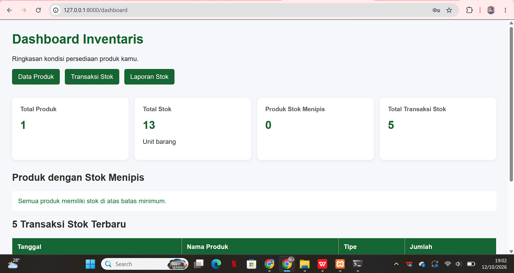
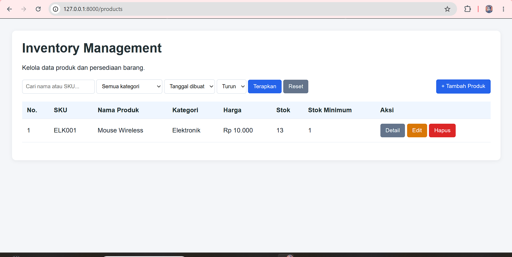
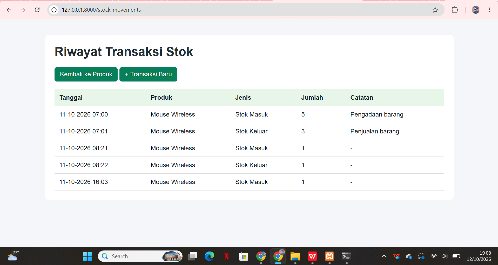
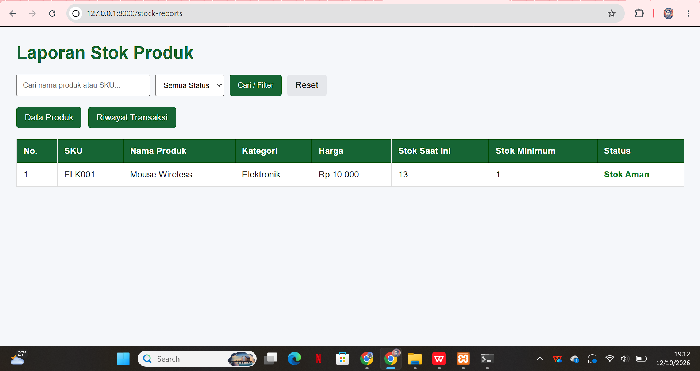

# Inventory Management System — Laravel

## Deskripsi Proyek

Inventory Management System adalah aplikasi berbasis web yang digunakan untuk mengelola data produk, memantau persediaan barang, mencatat transaksi stok, dan melihat laporan stok.

Aplikasi ini dikembangkan menggunakan Laravel dan database MySQL.

## Fitur Aplikasi

- Login dengan akun Admin dan Staff.
- Dashboard ringkasan persediaan.
- Manajemen produk (tambah, lihat, edit, dan hapus) dengan pembatasan akses Admin.
- Pencatatan transaksi stok masuk dan keluar.
- Laporan stok dengan pencarian dan filter.
- Validasi input dan pembaruan stok melalui transaksi database.

## Teknologi

- PHP
- Laravel
- MySQL / MariaDB
- Blade Template
- HTML dan CSS

## Screenshot Aplikasi

### 1. Dashboard

### 2. Data Produk

### 3. Transaksi Stok

### 4. Laporan Stok

## Arsitektur MVC

Aplikasi menggunakan pola arsitektur Model-View-Controller (MVC).

- **Model:** Mengelola data dan interaksi dengan database, misalnya model User dan Product.
- **View:** Menampilkan antarmuka kepada pengguna menggunakan Blade, misalnya halaman dashboard, produk, transaksi stok, dan laporan.
- **Controller:** Menangani request pengguna, validasi, proses bisnis, serta menentukan respons yang dikirimkan ke View.

Alur MVC secara umum adalah pengguna mengakses Route, Route memanggil Controller, Controller berinteraksi dengan Model jika diperlukan, kemudian mengembalikan View atau redirect.

## Instalasi

### Persyaratan

- PHP sesuai kebutuhan versi Laravel proyek.
- Composer.
- MySQL atau MariaDB.
- XAMPP atau lingkungan pengembangan PHP lainnya.

### Langkah Instalasi

1. Salin atau clone repository ke komputer.
2. Buka terminal di folder proyek.
3. Instal dependensi:

   `composer install`

4. Salin `.env.example` menjadi `.env`.
5. Buat database MySQL bernama `inventory_laravel`.
6. Sesuaikan konfigurasi database pada `.env`.
7. Buat application key:

   `php artisan key:generate`

8. Jalankan migration dan seeder:

   `php artisan migrate --seed`

   Jalankan perintah ini pada database pengujian yang sesuai. Jika database sudah berisi data, periksa migration dan seeder terlebih dahulu agar data tidak terduplikasi atau berubah tanpa sengaja.

9. Jalankan aplikasi:

   `php artisan serve`

10. Buka `http://127.0.0.1:8000` di browser.

## Catatan Keamanan

Jangan mengunggah file `.env` yang berisi password, kredensial database, atau informasi rahasia lainnya. Gunakan `.env.example` sebagai contoh konfigurasi.

## Demo Fitur

Alur demonstrasi aplikasi:

1. Login sebagai pengguna yang sesuai.
2. Buka form tambah produk.
3. Masukkan data dan periksa validasi.
4. Simpan data.
5. Amati redirect setelah penyimpanan berhasil.
6. Periksa data yang telah tersimpan pada halaman produk.
7. Tunjukkan pencatatan transaksi stok dan laporan stok.

## Pengembang

Proyek Inventory Management System untuk tugas Laravel Fundamental.
